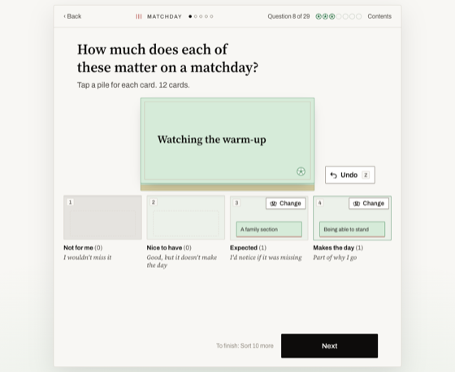
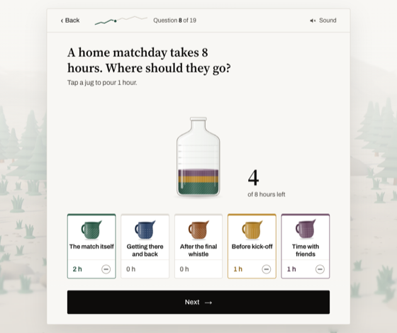

# Survey Kit

Two ways to run a survey that people actually finish, with everything needed to collect the answers: a sign-in
for you, a small database, and a CSV download for your analysis. It's a starting point for course projects, club
feedback and campus polls. Take it apart, rebrand it, keep what you like.

| Quiz-style | Game-style |
|---|---|
|  |  |
| One question per page on a plain paper page. People tap, sort cards into piles, stamp, rank or type a number. Plain HTML and JavaScript, so it also opens straight from a folder. | Set in a misty landscape, with a climber that shows progress. People pour hours from jugs, swipe cards and fill a podium. React components. |

Both come with the same sample: a short survey for football fans. It's there to show every kind of screen. Swap in
your own questions (see [From your questions to these screens](docs/your-questions.md)).

## Try it

You need [Node.js](https://nodejs.org) 22.13 or newer.

```bash
npm install
cp .env.example .env.local     # then set your own SURVEY_ADMIN_PASSWORD and SURVEY_SECRET in it
npm run dev
```

Open http://localhost:3000. The contents page shows both experiences.

- **Start** on either card takes the survey for real. Your answers are saved when you finish.
- **A row** in either list opens that one screen as a preview: Next always works and every follow-up shows.
- **Results** (top right) asks for your password, then shows what came in, with a CSV download for each experience.

## What's inside

| Path | What it is |
|---|---|
| `public/kit/` | The quiz-style experience and the contents page. `script.js` holds every question; `KIT.md` lists every screen type with what it saves |
| `src/kit/game/` | The game-style experience. `questions.ts` holds every question; its `README.md` lists the screen types |
| `src/app/api/responses/` | Where both experiences send finished surveys |
| `src/server/db.ts` | The database: one SQLite file, `data/survey.db` |
| `src/server/auth.ts`, `src/app/signin/` | Sign-in for you, the survey owner |
| `src/app/results/`, `src/server/csv.ts` | The results page and the CSV export |
| `docs/your-questions.md` | How to turn a list of questions into these screens, with a worked example |
| `e2e/` | Checks that click through everything in Chrome |

## How answers are collected

```
someone finishes a survey
   │  POST /api/responses  { experience: 'quiz' | 'game', respondent, answers }
   ▼
src/server/db.ts  ──►  data/survey.db  (table: responses)
   ▲
   │  you sign in at /signin, then open /results  ──►  Download CSV
```

**The database** is a single SQLite file, using the SQLite built into Node, so there is nothing to install or run.
It has one table:

| Column | Holds |
|---|---|
| `id` | 1, 2, 3… |
| `experience` | `quiz` or `game` |
| `respondent` | the code from a personal link, or empty |
| `submitted_at` | when it arrived, in UTC |
| `submission` | an id the browser makes for each finished survey, so a retry is stored once |
| `answers` | the answers as JSON |

To use Postgres or a hosted database instead (Supabase, Neon or Turso, for example), rewrite the three functions
in `src/server/db.ts`. Nothing else touches the database.

**The CSV** has one row per response and one column per answer. Quiz-style columns are named by step id (`1.1`,
`3.1.pint`); game-style columns by each question's `stores` key (`fan.why`, `rituals.shirt`). An answer with
several parts gets a column for each part, and a list of picks is joined with `; `. The file is UTF-8 (with a BOM,
so Excel keeps accents), and a cell that a spreadsheet would run as a formula gets a leading `'`. It opens in
Excel, Google Sheets, R (`read.csv`) or pandas (`pd.read_csv`).

**Sign-in** is for you, not the people answering. One password (`SURVEY_ADMIN_PASSWORD`, 8 characters or more)
unlocks `/results` and the downloads. It sets an httpOnly cookie signed with `SURVEY_SECRET` that lasts 8 hours;
changing either value signs everyone out. Wrong passwords are limited: 8 per visitor per 15 minutes when
`TRUST_PROXY=1` is set behind a host's proxy, otherwise 30 across all visitors. Use a long password. The sample
values in `.env.example` are refused, so a copy that was never edited can't be signed into. If you need accounts, for example several organisers or a university login, replace
`src/server/auth.ts` with [Auth.js](https://authjs.dev), [Clerk](https://clerk.com) or
[Supabase Auth](https://supabase.com/auth). Keep `isSignedIn()`: it's the only check the results routes call.

Anyone can send answers to `/api/responses` (that is what a public survey is), so it checks the size and shape of
what arrives: at most 200 KB, four levels deep and 1,000 values.

**The people answering** don't sign in. You have three choices:

1. **Anonymous.** Share the plain link. Answers arrive with no respondent.
2. **Personal links.** Add `?r=` and a code: `https://your-site/kit/index.html?r=A7K2` or
   `https://your-site/kit/game?live=1&r=A7K2`. The code is saved with their answers, so you can follow up,
   or match answers to a group, without asking for a name. It's kept for that browser session only, so the next
   person on a shared computer isn't tagged with it. Keep the list of who got which code somewhere else.
3. **Accounts.** Add a sign-in in front of the survey, as above, and send the user's id as `respondent`.

## Putting it online

Any host that runs Node and keeps a file between restarts works, for example
[Railway](https://railway.app) with a volume, [Render](https://render.com) with a disk, or
[Fly.io](https://fly.io) with a volume.

1. Push this repo to GitHub and create a service from it. The build command is `npm run build`; the start
   command is `npm start`.
2. Set `SURVEY_ADMIN_PASSWORD`, `SURVEY_SECRET`, `TRUST_PROXY=1`, and `DATA_DIR` to the mounted disk (for
   example `/data`).
3. Open the site, take each survey once, and check the answers on `/results`.

Serverless hosts such as Vercel and Netlify don't keep files, so the SQLite file would be lost. Use a hosted
database there (see above).

## Before you send it out

- Say at the start what you're collecting, why, and who will see it. Edit the welcome screen
  (`public/kit/script.js`, the step with `id: 'W'`; `WELCOME` in `src/kit/game/questions.ts`).
- Ask only what you'll use. Most projects don't need names or emails.
- If it's for a course or research, check whether your university needs ethics approval first.
- Keep the CSV somewhere private and delete it when the project ends.
- Take the survey yourself on a phone before anyone else does.

## Checking it

```bash
npm run build && npm start          # in one terminal
SURVEY_ADMIN_PASSWORD=... npm run check
node e2e/game-walk.mjs              # plays the game-style survey on a phone; DESK=1 for a laptop
node e2e/kit-walk.mjs               # clicks through every quiz-style screen
```

The checks drive Chrome through `puppeteer-core`. They look for Chrome at the macOS path; set `CHROME` to point
elsewhere.

## Licence

MIT. Use it, change it, ship it. See [LICENSE](LICENSE).
